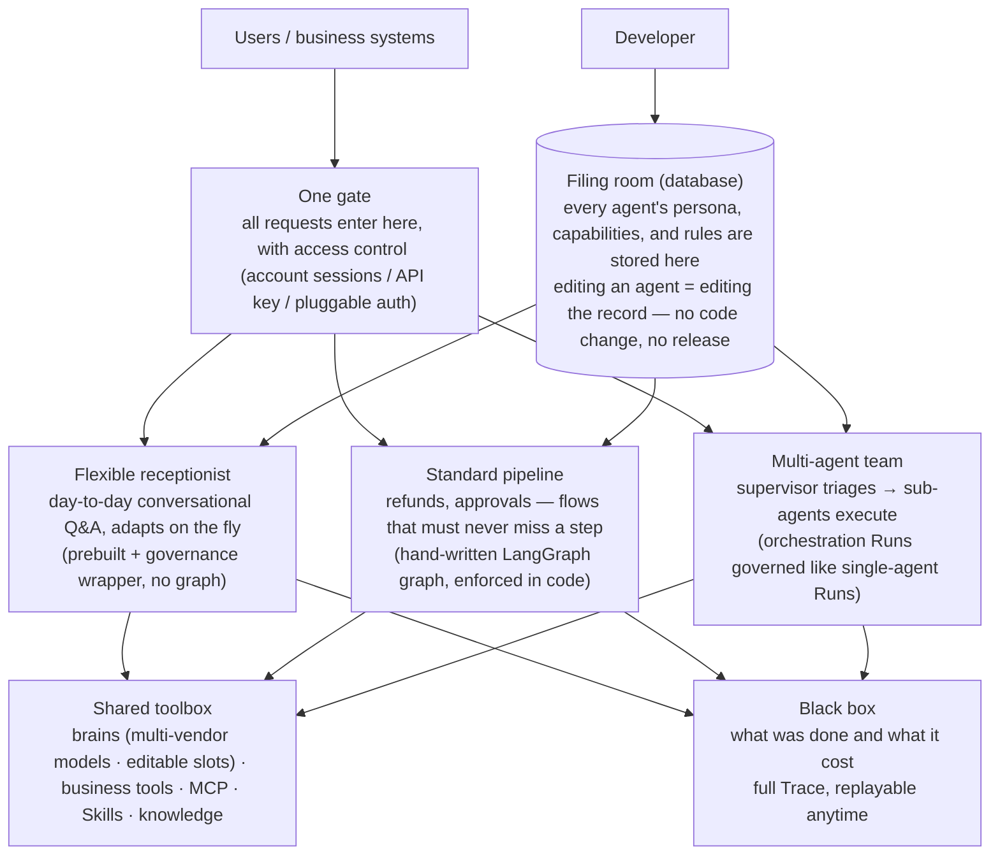
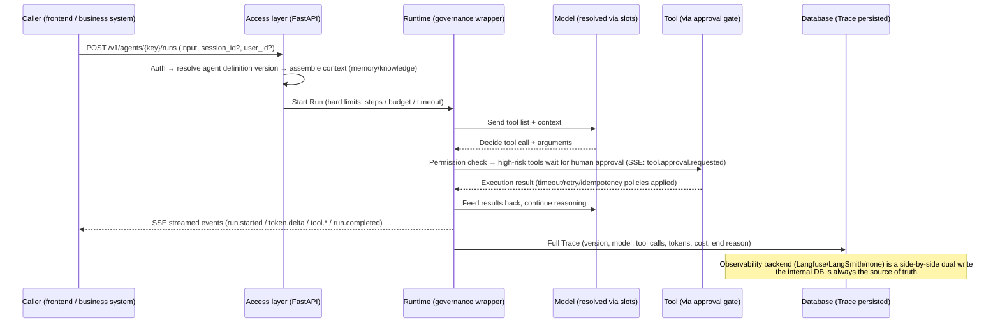
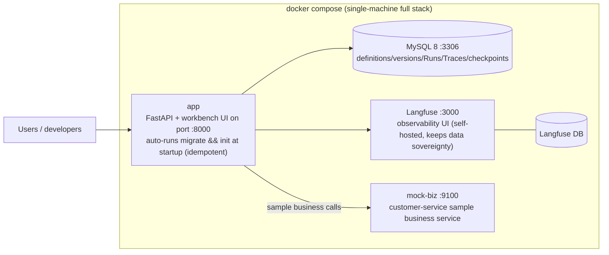

# Architecture

> This page answers four questions with four diagrams: how the system is layered, where your code and the framework live, how data flows through one Run, and what deployment looks like. Module-level details (interfaces / data / behavior / boundaries) live in `docs/specs/` (development docs); this page only covers what you must know to adapt the system.

## Diagram 1: System layers



The three execution forms share the same capability components and governance — this is "one engine, two usages (plus one multi-agent layer)": regular agents run without graphs, deterministic flows use graphs, and multi-agent is a supervisor topology on top of graphs.

## Diagram 2: Territories and directories (where you live, where the framework lives)

```text
LubanAgent/
├── lubanagent/    Framework territory — tracked upstream; in principle you don't touch it
│   ├── api/         FastAPI access layer (routes / auth / error mapping / OpenAPI contracts)
│   ├── core/        Domain models and extension-point protocols
│   ├── model/       Model factory (vendor adapters converge here only)
│   ├── runtime/     Agent loop / governance wrapper / SSE
│   ├── tool/        Tool execution and approval gate
│   ├── skill/       Skill loading and sandbox
│   ├── knowledge/   Minimal RAG
│   ├── graph/       Graph orchestration executor
│   ├── multiagent/  Supervisor delegation
│   ├── persistence/ ORM / repositories / migrations
│   ├── observability/ Trace / cost / evals / observability backend adapters
│   ├── mcp/         MCP Client / Server
│   ├── cli/         luban command line
│   └── ui/          Developer workbench frontend
├── app/           Your territory — your agents / tools / graphs / teams / configs live here; upstream never touches it proactively
│   ├── agents/      Agent YAML (for initial import)
│   ├── tools/       Your business tools
│   ├── graphs/      Your deterministic flows (convention-scanned entry points)
│   ├── skills/      Your Skill packages
│   └── config/      Environment config (.env)
├── website/       User documentation site (development guide + manual, VitePress, deployed separately)
├── docs/          Development docs (design docs / module specs / contracts) — for contributors and AI collaboration tools
├── demos/         Built-in customer-service example (living documentation)
├── tests/  migrations/  docker/  scripts/   Shared territory
```

The dependency direction is one-way: `app/* → lubanagent/*` is allowed; `lubanagent/* → app/*` is **forbidden** — at runtime the framework finds user extensions through the Registry (importing registers them) and never imports in the reverse direction. Two CI guards:

- **import-linter**: blocks reverse dependencies;
- **`.lubanagent-upstream` guard**: CI blocks upstream changes that hit user-owned paths.

This is the foundation of "clone, adapt, and still follow upstream upgrades"; see the [customization overview](./customization/overview.md) and [upgrading with upstream](./customization/upgrade.md).

## Diagram 3: Data flow of one Run



For event names and fields at each step, see [SSE events and error codes](./api/sse-and-errors.md).

## Diagram 4: Deployment topology (Docker Compose, five services)



The image is a three-stage build: Node builds the workbench frontend → venv → runtime. Required production changes (auth, real credentials, persistent volumes, changing the Langfuse password) are in the [deployment checklist](./deploy.md).

## Design principles at a glance

| Principle | In one sentence | Shown in |
| --- | --- | --- |
| Definitions in the database, versioned | An agent = a database record; editing config needs no release | [Agent definition](./features/agent-definition.md) |
| Decoupled logical brains | Switching models = editing a database mapping, no code change | [Model factory](./features/models.md) |
| Deterministic rules run in code | Permissions / amounts / approvals are not declared by prompts | [Tools and MCP](./features/tools-mcp.md), [graph orchestration](./features/graphs.md) |
| No black box, no forced SaaS | Full source; observability is switchable and removable; the internal DB is the source of truth | [Runtime observability](./features/observability.md) |
| Territory isolation | The user territory is separate; upgrades don't lose your changes | [Upgrading with upstream](./customization/upgrade.md) |
