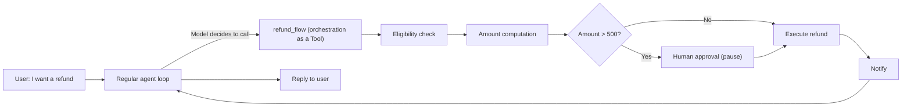

# Writing Graphs and Teams

> Regular conversational agents write no graphs (prebuilt + governance wrapper); flows that **must follow fixed steps** use graphs — a refund must check eligibility, then compute the amount, then approve, then execute. Handing that to a Skill or a prompt is "praying the model complies"; handing it to graph orchestration is "code guarantees execution."

## Graph orchestration (GraphBuilder)

**What it is**: LangGraph-based pipeline orchestration: step nodes (deterministic code or agent nodes), checkpoint persistence, pause/resume, human-approval nodes. Inside nodes, everything from the definition layer is reused (brain, Tools, governance, Trace).

**How it combines with LangChain**: nodes are ordinary Python functions that directly use this system's models and Tools — the same LangChain objects, no adapter layer. Three forms: node = Tool (deterministic step); node = Agent (the step needs model judgment); and **flow = Tool** — the whole pipeline hangs as one tool of an agent; the model decides when to enter the flow, and once inside, every step is guaranteed by code:



### Full GraphBuilder API

| Method | Purpose |
| --- | --- |
| `.entry(name)` | Entry node (required) |
| `.step(name, fn)` | Step node; `fn` receives a dict state and returns a dict |
| `.human(name, prompt=...)` | Human node — execution **pauses with interrupt** here, awaiting a human decision |
| `.edge(a, b)` | Normal edge, explicitly connecting two nodes |
| `.when(name, cond, then=..., otherwise=...)` | Conditional edge, routing branches on a state predicate |
| `.build()` | Validates the topology and returns the compiled graph |

### Complete example (refund pipeline)

```python
from lubanagent.graph import GraphBuilder

def _check_eligibility(state): ...   # Eligibility check, returns {"order": order, "checked": True}
def _compute_amount(state): ...      # Amount computation, returns {"amount": amt, "needs_approval": amt > 500}
def _execute_refund(state): ...      # Execute refund
def _notify(state): ...              # Notify

refund_flow = (
    GraphBuilder("refund_flow", description="退款流水线")
    .entry("check_eligibility")                          # Entry node (required)
    .step("check_eligibility", _check_eligibility)       # step(name, fn); fn receives a dict state and returns a dict
    .step("compute_amount", _compute_amount)
    .human("approve", prompt="金额 >500 元，需人工审批")  # Human node (separate method; interrupt pauses)
    .step("execute_refund", _execute_refund)
    .step("notify", _notify)
    .edge("check_eligibility", "compute_amount")        # Normal edges connect explicitly
    .when("compute_amount",                              # Conditional edge (separate method)
          lambda s: s.get("needs_approval"),
          then="approve", otherwise="execute_refund")
    .edge("approve", "execute_refund")
    .edge("execute_refund", "notify")
    .build()                                            # Validates the topology and returns the compiled graph
)

# Registered via @graph; importing this module registers it (app.graphs is the convention-scanned entry point)
from lubanagent.extension import graph

@graph(name="refund_flow", description="退款流水线")
def refund_flow_builder():
    return refund_flow
```

Files under `app/graphs/` are auto-scanned by `EXTENSION_PACKAGES` — importing the module registers it. Point the agent definition's refund entry at `refund_flow`; every transition writes Trace, and large amounts pause at the human node awaiting confirmation.

**Boundary**: orchestration is for "deterministic flows", not "all flows" — regular conversational agents need no orchestration and keep everything at the definition layer; don't draw a pipeline where no mandatory order exists, or you pay code cost for nothing. The workbench "Flow graphs" page provides a read-only topology view; **editing graphs happens in code** (changing a flow = changing code and releasing, keeping flows testable and auditable).

## Multi-agent teams (TeamBuilder)

**What it is**: one more layer above graph orchestration — composing "node = agent" into a supervisor / sub-agent delegation topology: the supervisor decides which sub-agent takes the next step, sub-agents report back when done, shared state flows between nodes, with conditional routing and human pausing.

**Key point: orchestration Runs enjoy the same governance as single-agent Runs** — every sub-agent call enters Trace (bound to its own definition version and actual model), the whole orchestration is subject to budget cutoffs, high-risk nodes can be human-confirmed, and orchestrations can be regression-tested and replayed through evals. No separate governance stack.

### TeamBuilder API

| Method | Purpose |
| --- | --- |
| `.supervisor(key)` | Set the supervisor — must be a **registered agent key** (with its own brain) |
| `.agent(key, description=...)` | Register a member sub-agent; description feeds the supervisor's routing decision |
| `.route(max_delegations=N)` | Only set the delegation cap; **routing is decided by the supervisor agent's LLM** |
| `.build()` | Build the team topology |

### Complete example (customer-service triage team)

```python
from lubanagent.multiagent import TeamBuilder

team = (
    TeamBuilder("cs-team", description="客服分流团队")
    .supervisor("cs-triage")              # The supervisor is a registered agent key (with its own brain)
    .agent("cs-faq", description="退货政策咨询")
    .agent("cs-refund", description="退款执行")
    .route(max_delegations=4)             # Only set the delegation cap; routing is decided by the supervisor agent's LLM
    .build()
)
```

The built-in example `app/multiagents/cs_team.py` is exactly this team, with a trigger entry `POST /v1/teams/cs-team/runs` exposed by `app/api/teams.py` — copy it to build your own team.

### Budget inheritance and cancellation propagation

Orchestration is not "a separate Run stack": **sub-Runs are sub-Runs of the session Run** — every sub-agent's Run inherits the parent Run's token budget (the whole orchestration cuts off when the line is hit), and cancelling the parent propagates cancellation to all sub-Runs. Governance semantics are identical to a single agent.

**Boundary**: multi-agent is optional — if one agent solves it, don't force multi-agent (you pay coordination cost and tokens for nothing). Code-first; no visual orchestration platform.
