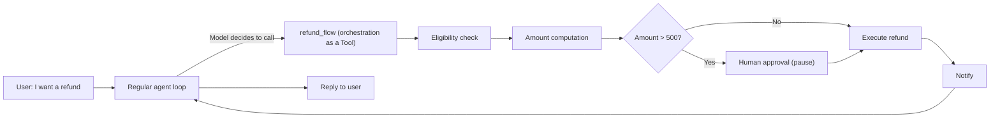

# Graph Orchestration

> This page covers when graph orchestration is needed, how it combines with LangChain, how the refund pipeline example is written, and the boundary of "orchestrate only deterministic flows."

**When it's needed**: the business flow has a mandatory step order — a refund must verify eligibility, then compute the amount, then approve, then execute, then notify; no step may be skipped and the order may not change. Handing this to a Skill or a prompt is "praying the model complies" with unstable results; handing it to graph orchestration is "code guarantees execution."

**What it is**: LangGraph-based pipeline orchestration: step nodes (deterministic code or agent nodes), checkpoint persistence, pause/resume, human-approval nodes. Inside nodes, everything from the definition layer is still reused (brain, Tools, governance, Trace).

**How it combines with LangChain**: nodes are ordinary Python functions that directly use this system's models and Tools — the same LangChain objects, no adapter layer. Three forms: node = Tool (deterministic step); node = Agent (the step needs model judgment); and **flow = Tool** — the whole pipeline hangs as one tool of an agent; the model decides when to enter the flow, and once inside, every step is guaranteed by code:



**How to use it** (illustrative):

```python
from lubanagent.graph import GraphBuilder

def _check_eligibility(state): ...   # Eligibility check, returns {"order": order, "checked": True}
def _compute_amount(state): ...      # Amount computation, returns {"amount": amt, "needs_approval": amt > 500}
def _execute_refund(state): ...      # Execute refund
def _notify(state): ...              # Notify

refund_flow = (
    GraphBuilder("refund_flow", description="退款流水线")
    .entry("check_eligibility")                          # Entry node (required)
    .step("check_eligibility", _check_eligibility)       # step(name, fn); fn receives a dict state and returns a dict
    .step("compute_amount", _compute_amount)
    .human("approve", prompt="金额 >500 元，需人工审批")  # Human node (separate method; interrupt pauses)
    .step("execute_refund", _execute_refund)
    .step("notify", _notify)
    .edge("check_eligibility", "compute_amount")        # Normal edges connect explicitly
    .when("compute_amount",                              # Conditional edge (separate method)
          lambda s: s.get("needs_approval"),
          then="approve", otherwise="execute_refund")
    .edge("approve", "execute_refund")
    .edge("execute_refund", "notify")
    .build()                                            # Validates the topology and returns the compiled graph
)

# Registered via @graph; importing this module registers it (app.graphs is the convention-scanned entry point)
from lubanagent.extension import graph

@graph(name="refund_flow", description="退款流水线")
def refund_flow_builder():
    return refund_flow
```

Point the agent definition's refund entry at `refund_flow`; every transition writes Trace, and large amounts pause at the human node awaiting confirmation. The read-only topology view of registered flows is in the [developer workbench](./workbench.md).

**Boundary**: orchestration is for "deterministic flows", not "all flows" — regular conversational agents need no orchestration and keep everything at the definition layer; don't draw a pipeline where no mandatory order exists, or you pay code cost for nothing.
