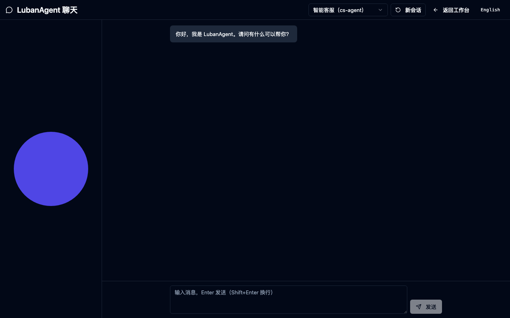

# 内置客服示例

> 本页讲仓库自带的完整客服示例演示什么、怎么回归，以及部门项目问答范本（dept-project）怎么复用。

## 页面入口与代码位置

| 在哪用 | 代码在哪 |
| --- | --- |
| 左侧「用户端聊天」（`/chat`）直接和客服 Agent 对话体验；运行回归用 `pytest tests/` | Agent 定义在 `app/agents/customer_service.yaml` 及 `cs_*.yaml`；工具在 `app/tools/customer_service/`；退款流程在 `app/graphs/refund_flow.py`；多 Agent 团队在 `app/multiagents/cs_team.py`；知识源在 `app/knowledge_sources/`；测试集在 `app/datasets/`；Mock 业务服务在 `demos/customer_service/`（Docker 里对应 `mock-biz` 服务） |

> 新手路径：运行这个示例见 [本地运行](../../tutorial/01-setup-and-first-run.md)。

完整可跑的客服 Agent：内置 Mock 业务服务（订单、退款、产品库）与最小 RAG 知识库，克隆即跑；自带测试集可回归。演示四幕：① 改定义（改人设/换大脑/调工具）不发版即时生效；② 高风险 Tool 触发人工确认、撞预算熔断，全程 Trace 回放；③ 跑评测出对比报告；④ **退款流水线**（[图编排](./graphs.md)）：资格校验 → 金额计算 → 大额人工审批 → 执行 → 通知，演示确定性流程如何落地；复杂进线由**多 Agent 协作**（分流 → FAQ/退款，见[多 Agent 协作](./multiagent.md)）处理。接真实业务服务的写法见[改造指南](../customization/overview.md)。

客服示例之外，仓库还自带一个**部门项目问答范本**（`dept-project` Agent + `project-docs` 知识源）：把五份项目核心文档灌进知识库，纯 RAG 问答 + 防错答守门——项目问题带 `[n]` 引用回答，知识库没覆盖的问题（如年假、做菜）在守门处直接拒答、不调模型（守门字段见[知识与记忆](./knowledge-memory.md)）。想给自己的部门/项目做一个小助手，照这套范本换掉文档清单和 Agent YAML 即可。
